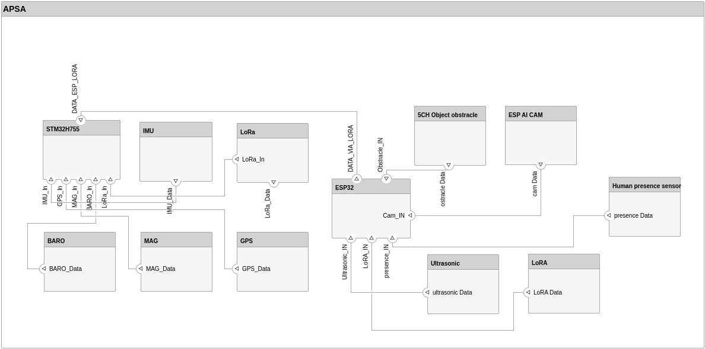

# APSA — Autonomous Perception and Sensor Agent

Board   : NUCLEO-H755ZI-Q (STM32H755ZI, Cortex-M7 480MHz + Cortex-M4 240MHz)
Master  : ESP32-S3 (240MHz, 8MB flash, 8MB PSRAM)
RTOS    : Zephyr v4.1.0
Status  : Production-ready, verified working

---

## The Problem This Project Solves

In a drone, if the IMU fails mid-flight, the flight controller loses
all attitude and motion data. The drone crashes.

The standard solution is hardware redundancy — a second physical IMU.
APSA takes a different approach: when the IMU fails, a CNN autoencoder
reconstructs IMU output from the last 512 samples in its history buffer
and feeds it into the sensor pipeline as if the IMU were still running.
This keeps the drone flying for up to 3 minutes while attempting recovery.

The key constraint: the AI output is not trusted blindly. Every reconstructed
sample is checked against physics constraints before entering the sensor queue.
Outputs that are all-zero, saturated, or whose acceleration magnitude falls
outside the physically valid range are rejected and treated as a sensor failure.
If the AI itself fails, the drone lands immediately. If 3 minutes pass without
IMU recovery, the drone also lands safely. The AI exists to bridge the gap
between IMU failure and either recovery or controlled landing — not to fly
the drone indefinitely.

This was verified working on hardware. The AI fallback activated, produced
physically valid output, and the system recovered cleanly when the IMU
was restored.

---

## System Overview

APSA runs on a dual-core STM32H755. The Cortex-M7 handles all sensor
fusion, AI inference, control, and micro-ROS communication. A second MCU,
the ESP32-S3, reads radar, ultrasonic, obstacle, line, and clip sensors
and sends them to the STM32 over LoRa 915MHz P2P.

Sensor data flows through a Sensor Abstraction Layer into an EKF/ESKF
estimator, then into LQR/MPC/SMC control algorithms. The ground station
receives /drone/* topics over micro-ROS via a FTDI adapter.

State machine:

  IMU OK,  AI OK            -> MONITOR / FUSION      normal flight
  IMU OK,  AI FAIL          -> MONITOR               AI offline, IMU flying
  IMU FAIL, AI OK           -> VIRTUALIZE -> FUSION  AI takes over
  IMU FAIL, AI OK, >3 min  -> LANDING               AI timeout, safe landing
  IMU FAIL, AI FAIL         -> EMERGENCY -> LANDING  both failed, land now
  IMU recovers              -> RECOVERY -> MONITOR   back to normal

---

## Hardware

STM32 side:
  IMU  : ICM-42688-P  SPI1   SCK=PA5  MISO=PA6  MOSI=PB5  CS=PD14
  MAG  : QMC5883P     I2C4   SCL=PF14 SDA=PF15  addr=0x2C
  BARO : DPS310       I2C1   SCL=PB8  SDA=PB9   addr=0x77
  GPS  : NEO-M8N      USART1 TX=PB6   RX=PB7    9600 baud
  LoRa : DFRobot LWNode 915MHz  UART4  TX=PC10  RX=PC11  9600 baud
  Console  : USART3   TX=PD8  RX=PD9   115200 baud  ST-LINK VCP
  micro-ROS: USART6   TX=PC6  RX=PC7   115200 baud  FTDI adapter

ESP32-S3 side:
  Radar C4001        : Serial2  RX=9   TX=8    9600 baud
  Ultrasonic HC-SR04 : TRIG=15  ECHO=16
  Obstacle S1-S5     : pins 10-14
  Clip sensor        : pin 5
  Near sensor        : pin 6
  I2C Line Reader    : SDA=1  SCL=2  addr=0x53
  LoRa               : Serial1  RX=18  TX=17   9600 baud
                       My addr=2 (ESP32)  Peer addr=1 (STM32)

---

## AI Virtual Sensor

Model     : CNN Autoencoder (int8, X-CUBE-AI 10.2.0)
Input     : 512 IMU samples — ax, ay, az, mag_x — int8 time-major
Output    : 512 reconstructed samples — int8 time-major
Flash     : 59 KB
RAM       : 26 KB
Inference : 7 ms on Cortex-M7 at 480 MHz

During normal flight the model receives every IMU sample and keeps its
history buffer full. No inference runs — it stays on standby.
When the IMU fails, the last 512 samples feed the model. Every output
sample passes physics constraint validation before entering the sensor queue.

Verified in hardware log:
  [AI-FALLBACK] Sensor recovered (normal=2801, fallback=395)
  [AI-FALLBACK] Sensor recovered (normal=2901, fallback=395)
  [AI-FALLBACK] Sensor recovered (normal=3001, fallback=395)

---

## ROS2 Topics

  /drone/imu      sensor_msgs/Imu             1 Hz
  /drone/pose     geometry_msgs/PoseStamped   1 Hz
  /drone/health   std_msgs/String             1 Hz
  /drone/fault    std_msgs/String             on event
  /drone/control  geometry_msgs/Twist         1 Hz

---

## System Architecture

  ESP32-S3              STM32H755                  PC
  Radar      LoRa       IMU, MAG, BARO, GPS        micro_ros_agent
  Ultrasonic <------>   AI Virtual Sensor  <------> /drone/imu
  Obstacle   915MHz     EKF/ESKF                    /drone/pose
  Line                  LQR/MPC/SMC                 /drone/health
  Clip                  micro-ROS (USART6/FTDI)     /drone/fault
                                                    /drone/control

  ESP32 -> STM32 : US:XX.X, S:XXXXX, H:X, X,Y  (LoRa AT+SEND)
  STM32 -> ESP32 : CONFIRM
  STM32 -> PC    : /drone/* topics via micro-ROS

---

## Build from Source

Requirements: Linux, 10GB free disk space

Download full environment (Zephyr SDK + west + venv + micro-ROS, ~7GB):
https://drive.google.com/file/d/1nJowpYsaRMkd-KCEaE6X97rAPc1WYu8L/view?usp=sharing

cd ~
tar xzf zephyr_full_setup.tar.gz

Verify before building:
ls -d ~/zephyrproject ~/zephyr_project ~/zephyr_microros_venv ~/.local/zephyr-sdk-0.17.0

Build:
source ~/zephyr_microros_venv/bin/activate
source ~/zephyrproject/zephyr/zephyr-env.sh
cd ~/zephyr_project
west build -b nucleo_h755zi_q/stm32h755xx/m7

Flash:
west flash

Serial monitor:
picocom -b 115200 /dev/ttyACM1 --logfile ~/run.log

---

## Flash Pre-built Binary

git clone https://github.com/ephemeris-void/apsa.git
cd apsa
west flash --hex-file prebuilt/zephyr.hex

---

## micro-ROS Agent

Terminal 1:
distrobox enter ros2
source /opt/ros/jazzy/setup.bash
source ~/microros_ws/install/local_setup.bash
ros2 run micro_ros_agent micro_ros_agent serial --dev /dev/ttyUSB0 -b 115200 -v6

After agent starts, press reset (B2) on the board.

Terminal 2:
distrobox enter ros2
source /opt/ros/jazzy/setup.bash
source ~/microros_ws/install/local_setup.bash
ros2 topic list
ros2 topic echo /drone/imu --once
ros2 topic echo /drone/health --once

---

## Ports

/dev/ttyACM1 : ST-LINK VCP   STM32 USART3  serial log
/dev/ttyUSB0 : FTDI adapter  STM32 USART6  micro-ROS
/dev/ttyACM0 : ESP32 USB

---

## Simulink Model

📥 [Download .slx file](Simulink_Model/APSA.slx)
